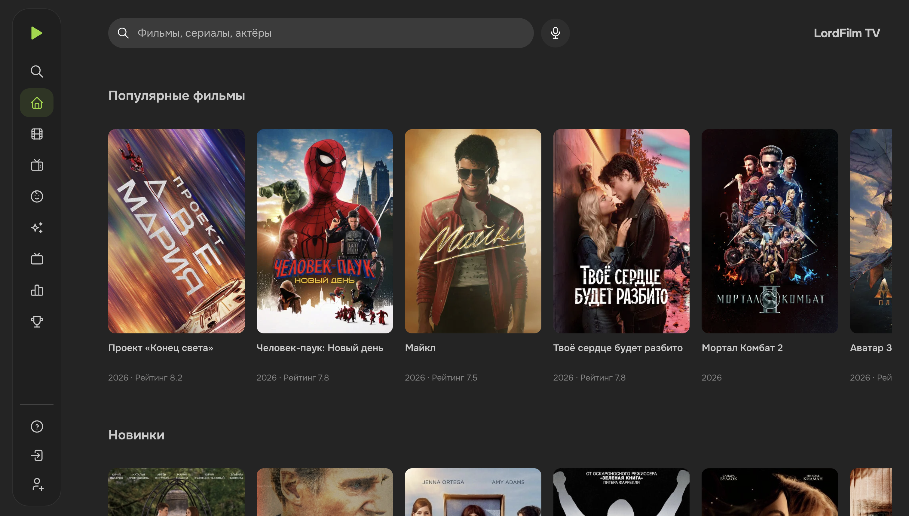

# LordFilm TV

### Your next movie. Your remote. Your big screen.

Browse movies and TV shows in a clean, cinema-inspired interface built for the couch. Explore poster collections, find a title, and start watching with your TV remote.

**Install one APK and open the catalog.** The Android app runs on your TV or streaming box without a companion computer or your own backend server.

**[Download for Android TV](https://github.com/AndreiTka4iov/lordfilm-tv/releases/download/v0.2.0-preview.1/lordfilm-tv-0.2.0-preview.1.apk)** · [All releases](https://github.com/AndreiTka4iov/lordfilm-tv/releases) · [Report a bug](https://github.com/AndreiTka4iov/lordfilm-tv/issues)



## Made for movie nights

| Feature                     | What you get                                                                                              |
| --------------------------- | --------------------------------------------------------------------------------------------------------- |
| Discover something to watch | Browse popular movies, new releases, and TV shows with large posters and dedicated detail pages.          |
| Stay on the remote          | Move with the arrows, select with OK, and return with Back. The sidebar expands when you focus it.        |
| Find your next watch        | Search by title or actor. Results update as you type. Voice input is available where supported.           |
| Settle into a series        | Choose a season and episode, switch audio tracks or quality when available, and move to the next episode. |
| Make it yours               | Choose a light or dark theme, with clear focus states and smooth card transitions.                        |
| Run it your way             | Install the standalone Android APK, or self-host the web client with its separate API.                    |

The interface is currently in **Russian**. This is an independent community project built around public LordFilm sources.

## Get it on your TV

1. **[Download the APK](https://github.com/AndreiTka4iov/lordfilm-tv/releases/download/v0.2.0-preview.1/lordfilm-tv-0.2.0-preview.1.apk)** from GitHub Releases.
2. Transfer it to your Android TV device or streaming box.
3. Open the APK with a file manager and allow installation from that app when prompted.
4. Launch **LordFilm TV** and pick something to watch.

**Requirements:** Android 7.0+ and Android System WebView/Chromium **111 or newer**, plus an internet connection. Check the WebView version as well as the Android version.

The current download is **0.2.0 Preview 1**, signed with a test key and using package `tv.lordfilm.app.debug`. [Release notes and SHA-256 checksum](https://github.com/AndreiTka4iov/lordfilm-tv/releases/tag/v0.2.0-preview.1) are available with the APK.

## A few things to know

**Do I need to keep a computer running?**

No. The Android APK includes the interface and fetches catalog and playback data directly. The self-hosted web version needs its own API process.

**Can I use a regular TV remote?**

Yes. Use the arrows to browse, OK to select, and Back to return. In the player, Left and Right seek, Up opens the controls, and OK pauses or resumes playback.

**Does it work on every Android TV device?**

It needs a compatible WebView engine. Devices with an older engine receive an update prompt. Playback and hardware decoding also depend on the device.

**What is ready today?**

Home collections, search, movie and series details, and HLS playback. The project is in active development: other menu sections are placeholders, and accounts and automatic playback restoration are not implemented. Catalog, artwork, and video availability depend on external sources and your network.

## Help shape the next version

Found an issue or have an idea? [Open an issue](https://github.com/AndreiTka4iov/lordfilm-tv/issues) with your device model, Android and WebView versions, and steps to reproduce. Screenshots help too. Contributions to remote navigation, device compatibility, and playback are welcome.

Want to build your own version? The app uses **Next.js, React, TypeScript, Mantine, Tailwind CSS, and Kotlin**, with Feature-Sliced Design and automated browser and Android checks.

<details>
<summary><strong>Developer guide — local setup, Docker, Android builds, and API</strong></summary>

## Run the web app locally

Requires Node.js 24 (the exact version is in `.nvmrc`) and npm 11 or 12.

```sh
git clone https://github.com/AndreiTka4iov/lordfilm-tv.git
cd lordfilm-tv
nvm use
npm ci
cp .env.example .env
npm run api:dev
```

In another terminal:

```sh
npm run dev
```

Open http://localhost:3000. The API listens on http://localhost:3001. Both processes are required for the web catalog. Next.js and the API commands read the local `.env` file, which is excluded from Git.

### Configuration

| Variable                      | Default / purpose                                                                                        |
| ----------------------------- | -------------------------------------------------------------------------------------------------------- |
| `LORDFILM_ORIGIN`             | Source origin from `.env.example`; update it if the source domain changes                                |
| `API_HOST`                    | `127.0.0.1`; use `0.0.0.0` for direct LAN access                                                         |
| `API_PORT`                    | `3001` — local API port                                                                                  |
| `API_CORS_ORIGIN`             | `http://localhost:3000` — exact frontend origin, including the port                                      |
| `NEXT_PUBLIC_CATALOG_API_URL` | Empty: use the current page's hostname on port `3001`. Accepts an HTTPS URL or reverse proxy path prefix |
| `HOST_BIND`                   | `127.0.0.1` — bind address for published Docker ports                                                    |
| `FRONTEND_OUT_PORT`           | `3000` — published frontend Docker port                                                                  |
| `API_OUT_PORT`                | `3001` — published API Docker port                                                                       |

To test the web app in a TV browser, start the frontend with `npm run dev:lan`, set `API_HOST=0.0.0.0`, and set `API_CORS_ORIGIN` to the page's LAN origin. On a TV, `localhost` refers to the TV itself. If you change the frontend or API ports, update the API URL and allowed origin accordingly.

`NEXT_PUBLIC_*` values are exposed to the browser and embedded at production/export build time. Never store secrets in them. An HTTPS frontend requires an HTTPS API or a proxy on the same origin.

## Builds and Docker

```sh
npm run build
npm start             # Production Next.js server, localhost:3000
npm run api:start     # Separate API process
npm run build:export  # Static files in .next-export/
```

The static export can be served by any HTTP server that supports directory `index.html` files. The API remains a separate process. A static export does not produce an APK on its own.

For Docker, choose one frontend mode and start the API:

```sh
npm run docker:run:api
npm run docker:run:dev     # Development, bind mounts, and Fast Refresh
# Or:
npm run docker:run:prod    # Next.js standalone
# Or:
npm run docker:run:static  # Static export + Nginx
```

Frontend modes share the same published port. Before switching, run `npm run docker:stop:dev`, `docker:stop:prod`, or `docker:stop:static`. Stop the API with `npm run docker:stop:api`. Stopping preserves the containers. View frontend logs with `npm run docker:logs:dev` (or `prod`/`static`), and API logs with `docker compose -f docker-compose.api.yml logs -f`.

Ports are bound to localhost by default. For LAN access, set `HOST_BIND=0.0.0.0` and the exact `API_CORS_ORIGIN` in `.env`. Compose uses `.env` for configuration substitution and passes the public API URL into the build. Rebuild images after changing dependencies or build-time settings. For public deployment, configure TLS and request limits at the reverse proxy; the API does not implement authentication.

## Build the Android APK

The `android/` project uses Kotlin and WebView, with Android 7.0 (API 24) as the minimum OS version. It requires Android System WebView/Chromium **111 or newer**. The Android version alone does not guarantee compatibility: devices with an older WebView, such as version 83, receive a prompt to update the engine. To build the app, install JDK 17 and Android SDK Platform 36 through Android Studio, then configure `ANDROID_HOME` or a local `android/local.properties` file (`sdk.dir=…`). On macOS:

```sh
export JAVA_HOME=$(/usr/libexec/java_home -v 17)
npm ci
npm run android:build
```

Output: `android/app/build/outputs/apk/debug/app-debug.apk`. The command creates a fresh web export, checks Kotlin formatting, runs Kotlin tests and Android Lint, and verifies that every web asset is included in the APK. The Gradle Wrapper is included in the repository. `NEXT_PUBLIC_CATALOG_API_URL` applies only to the web app and is not used inside the APK.

The catalog opens immediately on launch. The app has no connection settings or local HTTP server. The source origin is fixed at build time. To use a different source mirror:

```sh
npm run android:prepare
cd android
./gradlew -PlordfilmOrigin=https://your-source.example verifyDebugWebAssets
```

The shell loads only packaged pages through WebViewAssetLoader at the HTTPS origin `https://appassets.androidplatform.net`. React sends paths from the existing contract (`/v1/…`) through an asynchronous WebMessage bridge restricted to that origin. Kotlin returns the same DTOs. These are in-process messages, not network API requests. The web app continues to use a separate HTTP API.

Bridge protocol: request `{id, path}`, response `{id, status, body}`, cancellation `{cancel: id}`. Only known catalog operations are accepted; arbitrary URLs are rejected. Android runs two network jobs with a queue of up to six; excess requests receive 503. Responses are limited to 128 KiB, source HTML to 4 MiB, and provider HTML to 2 MiB. Each HTTP call has a 10-second timeout. Requests are cancelled when the screen or search query changes. Native connections and jobs are closed when the Activity is destroyed. Catalog data and search results are not cached on disk.

Source-hosted posters and backgrounds (`xfields.poster` / `posterbg`) take priority. For popular titles, poster addresses are resolved lazily, with up to two concurrent page requests. Up to 64 addresses are kept in memory for five minutes; this cache contains neither HTML nor images. Source images and fallback TMDB posters are fetched by the native HTTP client and streamed to WebView, with up to four concurrent transfers and a 4 MiB limit per image. There is no custom image cache. For `image.tmdb.org`, the app uses Cloudflare DNS-over-HTTPS with Google DNS as a fallback and TLS verification. This avoids system DNS responses that map the domain to loopback without changing device settings. Other domains use system DNS. Local and loopback DNS answers are rejected, and positive answers are kept for up to 30 seconds. At least one of these resolvers must be reachable over HTTPS. The app neither disables certificate verification nor accepts arbitrary image URLs.

Arrows and OK use the existing TV navigation. Back is passed to the current screen first, then to navigation history; at the root, the app asks before exiting. Media keys are forwarded to the web player. When the app enters the background, the player closes and releases its resources. Automatic playback restoration is not implemented. Voice input depends on Web Speech support in WebView; keyboard input remains available when it is unsupported.

```sh
npm run test:android:web # Export, native transport without an HTTP API, search, and cancellation
cd android
./gradlew checkKotlinFormat testDebugUnitTest lintDebug verifyDebugWebAssets assembleRelease
```

The editable banner is `android/branding/tv-banner.svg`; the square icon is `android/app/src/main/res/drawable/app_icon.xml`. After changing the banner, run `npm run android:branding` (requires Chromium: `npx playwright install chromium`). The generated PNG is committed, so normal APK builds do not require artwork generation.

Format Kotlin and Gradle scripts with `./gradlew formatKotlin` from the `android/` directory.

Release output: `app/build/outputs/apk/release/app-release-unsigned.apk`. Sign it with your own permanent Android key before distributing it. The debug APK uses a test key and is intended for testing. GitHub Actions saves it as an artifact of the Android job. External sources and CDNs may still be unavailable on a particular network; their availability no longer depends on your own server.

## API and data source

| Method | Path                              | Result                                                           |
| ------ | --------------------------------- | ---------------------------------------------------------------- |
| GET    | `/v1/catalog/pools/{group}`       | 20 titles; `group`: `popular`, `new`, `series`                   |
| GET    | `/v1/catalog/search?q=…`          | Up to 40 titles; query length: 2–200 characters                  |
| GET    | `/v1/movies/{id}/{slug}`          | Movie or TV show details                                         |
| GET    | `/v1/movies/{id}/{slug}/playback` | Playback information; optional `season` and `episode` parameters |

Contract: [OpenAPI](postman/specs/catalog.openapi.json). Postman requests, local mocks, and simulations are in `postman/`. A Postman account is not required to run the app or automated tests.

The adapter reads data from public LordFilm pages without executing their scripts. `popular` uses `/top-100`, `new` uses `/filmy`, and `series` uses `/serialy`. Ordering comes from the source: the New Releases shelf does not guarantee release-date sorting. Titles are unique within each collection but may appear in multiple collections. Search uses `/search` with `search_text_mode=full`. Pagination is not implemented; users are prompted to refine the query when the result limit is reached.

The web API caches collections on the server for five minutes and coalesces concurrent requests. Search and playback responses are not cached. Source failures return 502 and timeouts return 504; missing data is not replaced with fictional entries. HTML is limited to 4 MiB, and source requests have a 10-second timeout. CORS permits only the configured origin. There is no arbitrary URL proxy.

Playback uses the Collaps provider. Video is streamed directly from the CDN; the API does not store or proxy media segments. The provider-specific HTTP transport is implemented in `cdn-loader.ts`. Changes to the domain, page format, or provider may require adapter updates. Source availability and signed links depend on the network. The project does not provide a stable external API.

## Memory and TV navigation

The client retains only the current screen's data: up to 60 home screen titles or 40 search results. Catalog data is not cached in localStorage or IndexedDB. Requests are cancelled when leaving a screen or changing the query, and stale responses are ignored. A shared IntersectionObserver unloads offscreen posters.

The player and HLS.js load only after selecting Watch. Adaptive quality is capped at 720p by default. The target buffer is 10 seconds, the maximum is 20 seconds / 8 MiB, and the back buffer is zero. These are HLS settings, not a hard limit on browser memory. Closing the player destroys HLS, its worker, MediaSource, requests, and timers.

Arrows move focus. Left from the content edge opens the menu; Right from the menu returns to the content. In the player, OK/Space toggles playback, Left/Right on the video seek by 10 seconds, Up opens the controls, and Back/Escape closes the player. Voice input starts only when the microphone button is selected.

## Development and contributions

```text
src/app       Routes and root layout
src/core      Providers and application composition
src/views     Screens; the FSD pages layer
src/widgets   Self-contained interface blocks
src/features  User actions
src/entities  Catalog models and components
src/shared    Configuration, locales, theme, and utilities
server        HTTP API, catalog adapter, and playback provider
```

ESLint enforces FSD dependency direction and public slice APIs. TypeScript runs in strict mode, including unused code checks. The UI uses Mantine and Tailwind; user-facing strings live in `src/shared/locales`. See [AGENTS.md](AGENTS.md) for detailed conventions.

```sh
npm run check
npx playwright install chromium # Once; use --with-deps on Linux CI
npm run test:e2e
npm run build
npm run build:export
```

Browser tests start the frontend on port 3100 and replace external APIs and media with fixtures. They do not require a live source or a separate API process. Set `TEST_BASE_URL` to test an already running frontend. API HTTP tests start local servers and cover validation, parsing, caching, timeouts, and errors. Media in `tests/e2e/fixtures/media` is a synthetic test clip.

Before opening a PR, run the checks above and describe the behavior change and how you verified it. For bug reports, include reproduction steps and browser/WebView and device versions. Remove private data from logs. GitHub Actions checks the code, browser scenarios, both web builds, Compose configurations, and Docker images. A separate Android job checks Kotlin, native tests, Lint, and APK packaging; its debug APK is available in the workflow artifacts.

</details>
